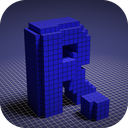
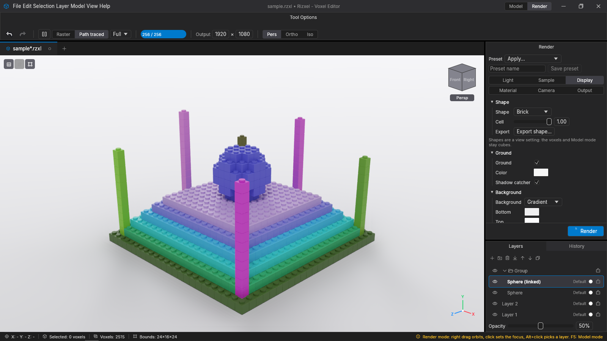
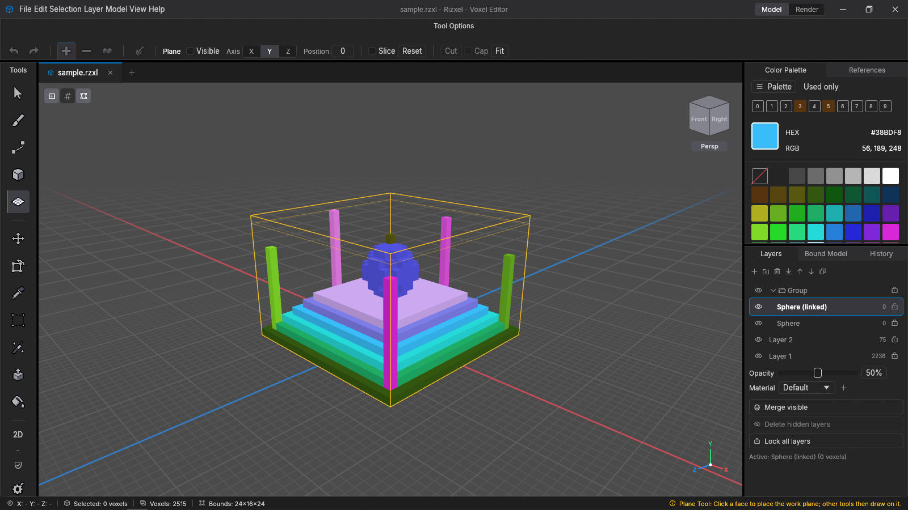
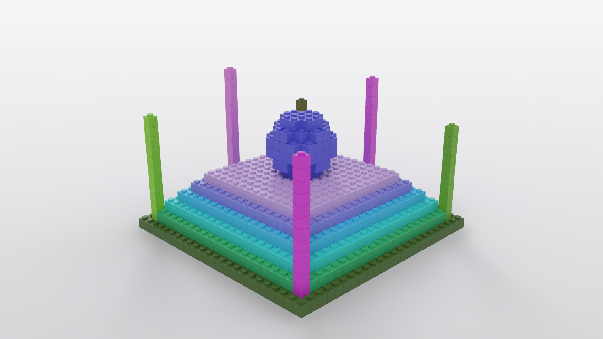

<div align="center">



# Rizxel

**A native voxel art editor written in pure Rust, with a built-in path tracer.**

[](https://github.com/MRizky099/Rizxel/actions/workflows/ci.yml)
[](https://github.com/MRizky099/Rizxel/tags)
[](LICENSE)
[](rust-toolchain.toml)
[](#requirements)
[](Cargo.toml)



</div>

Rizxel is a voxel editor for pixel-art style 3D models. It uses `egui` for the interface
and `wgpu` for the viewport. You can model with a full set of voxel tools, organize the
model in layers, and then render it with a progressive GPU path tracer, all in one
lightweight app. Its voxel model and tools draw on Goxel, MagicaVoxel and Qubicle, and
it reads and writes their file formats.

> **Status: beta (`0.9.0`).** Rizxel is under active development, and the
> `.rzxl` format may still change before 1.0 (older files keep loading). See the
> [changelog](docs/CHANGELOG.md) and [roadmap](#roadmap).

## Contents

- [Screenshots](#screenshots)
- [Features](#features)
- [Requirements](#requirements)
- [Getting started](#getting-started)
- [Controls](#controls)
- [File formats](#file-formats)
- [Architecture](#architecture)
- [Roadmap](#roadmap)
- [Contributing](#contributing)
- [Documentation](#documentation)
- [Acknowledgements](#acknowledgements)
- [License](#license)

## Screenshots

| Model mode | Photo-realistic render |
|---|---|
|  |  |
| Editing tools on the left, the viewport with the view cube in the middle, and the palette, layer tree and history on the right. | A 1920×1080 *Photo-realistic* render of the same model with the **Studio White** preset and the **Brick** voxel shape. |

The demo model comes from `cargo run -p rizxel-app --example sample_model`.

## Features

**Modelling**

- **Tools**: Cursor, Brush, Line (lines, polylines and curves with a pixel-perfect
  option), Shape (cube, sphere, cylinder, pyramid, cone), Plane (work plane and
  Qubicle-style Slice Mode), Move, Transform (free rotate and resize), Color Picker,
  Selection, Fuzzy Select, Extrude and Fill. Each tool has Add / Subtract / Join / Paint
  modes, symmetry and antialiasing.
- **Selection**: an adjustable 3D box, Set / Add / Subtract masks, Grow, Shrink, By
  Color, Invert, To New Layer, and Mask Mode to protect the selected voxels.
- **Structure tools**: Separate Parts, Split at Work Plane, layer Booleans, Fit Bounds to
  Content, Fill Hollows and Hollow.
- **Clipboard and transforms**: copy, cut, a floating paste that follows the cursor,
  paste to a new layer, rotate 90°, flip and mirror.
- **Palette**: `.gpl` and `.hex` files, sort, remap, gradient, remove duplicates, snap to
  palette, a used-colors view and favorite colors on `Ctrl+0` to `Ctrl+9`.

**Organizing**

- **Layers**: a layer tree with nested groups and inherited lock, linked clones,
  procedural shape layers, non-destructive crop, opacity, ghosts and per-layer materials.
- **Reference images** on the XZ, XY or YZ plane, managed in their own panel.
- **Undo and history**: one drag is one undo step, and the History panel jumps to any
  step.
- **Safe editing**: a Save / Don't Save / Cancel prompt on every close path, autosave
  with crash recovery, and a recent files list.

**Viewing and rendering**

- **Viewport**: wgpu with 4× MSAA, perspective, orthographic and isometric cameras,
  ambient occlusion, an infinity grid, a voxel grid on the model, and a view cube with
  26 targets. Large models are meshed in the background.
- **Render mode**: its own workspace with a progressive GPU path tracer (Vulkan or
  Metal): sun, sky, HDR
  and studio lights, presets, materials with glass, metal and emission, depth of field,
  a denoiser, and view-only voxel shapes (cubes, rounded, bricks with studs, spheres,
  cylinders).
- **Render outputs**: *Image* (fast raster), *Photo-realistic* (path traced, up to
  8192 px) and *Turntable* (a PNG sequence, a sprite sheet or a GIF), plus export of the shaped
  mesh to OBJ, STL or GLB.

**Workspace**

- Dockable and floating panels in tab groups with scrolling tab strips, document tabs,
  Zen mode, and a frameless window with the Model / Render switch in the title bar.

## Requirements

| | |
|---|---|
| **OS** | Windows 10/11, Linux (X11 or Wayland) or macOS 11+. All three are built and tested in CI. |
| **GPU** | Any GPU with Vulkan, Direct3D 12 or Metal for the viewport. The path tracer runs on **Vulkan or Metal** (Windows GPUs normally ship Vulkan drivers); on other backends Render mode keeps the raster preview and the *Image* output. |
| **To build** | Rust 1.85 or newer (pinned through `rust-toolchain.toml`). On Linux, the X11/Wayland and GTK development packages listed in [`.github/workflows/ci.yml`](.github/workflows/ci.yml). |

## Getting started

### Download

Packages are attached to every release on the
[Releases page](https://github.com/MRizky099/Rizxel/releases) (from the 0.9 beta on):

| Platform | Package | Notes |
|---|---|---|
| Windows 10/11 | `Rizxel-<version>-windows-x64.msi` | Installs per user (no admin rights) and opens `.rzxl` files with Rizxel. |
| Windows 10/11 | `Rizxel-<version>-windows-x64.zip` | Portable: unzip and run `rizxel.exe`. *Settings ▸ General ▸ Associate .rzxl Files* adds the file association. |
| Linux (x86-64) | `Rizxel-<version>-x86_64.AppImage` | `chmod +x` and run. *Settings ▸ General* registers `.rzxl` files, or let AppImageLauncher integrate it. |
| macOS 11+ | `Rizxel-<version>-macos-universal.dmg` | Apple silicon and Intel. Drag Rizxel to *Applications*. |

The beta packages are not code-signed: Windows SmartScreen and macOS Gatekeeper warn on
the first start (on macOS, right-click the app and choose *Open*). Every package contains
`LICENSE` and `THIRD_PARTY_LICENSES.html`, and every release links the source code it was
built from.

Double-clicking a `.rzxl` file while Rizxel is open opens it as a new tab in the running
window.

### Build from source

```bash
git clone https://github.com/MRizky099/Rizxel.git
```

```bash
cd Rizxel
```

```bash
cargo run -p rizxel-ui --release
```

Open a file at startup:

```bash
cargo run -p rizxel-ui --release -- path/to/model.rzxl
```

Write the demo project shown in the screenshots:

```bash
cargo run -p rizxel-app --example sample_model
```

Convert between formats without the UI:

```bash
cargo run -p rizxel-app --example convert -- input.vox output.glb
```

### Tests

```bash
cargo test --workspace
```

```bash
cargo clippy --workspace --all-targets -- -D warnings
```

A few tests compare against real files: MagicaVoxel's `chr_knight.vox` sample, its
`chr_knight.obj` export, and a Goxel file named `coba_goxel.gox`. They look for them in
the folders listed in `RIZXEL_SAMPLES` (separated with `;` on Windows, `:` elsewhere) and
skip when it is unset, as on CI. In PowerShell:

```powershell
$env:RIZXEL_SAMPLES = "D:\samples\magicavoxel;D:\samples\goxel"
```

`RIZXEL_DATA_DIR` points Rizxel's settings, layout, recent files and autosaves to another
folder, for example to try a build without touching your own settings.

### Packages

The [release workflow](.github/workflows/release.yml) builds every package when a `v*` tag
is pushed and attaches them to a draft release. To build one locally, first write the
third-party notices with [`cargo-about`](https://github.com/EmbarkStudios/cargo-about)
(the command fails on a dependency license that isn't on the GPL-compatible allow-list in
[`about.toml`](about.toml)):

```bash
cargo install cargo-about --locked --features cli
```

```bash
cargo about generate --fail about.hbs -o THIRD_PARTY_LICENSES.html
```

```bash
cargo build --release -p rizxel-ui
```

Then run the platform's script from the repository root:

| Platform | Script | Needs |
|---|---|---|
| Windows | `pwsh packaging/wix/build.ps1 -Version 0.9.0` (`-NoMsi` for the zip only) | [WiX Toolset 5](https://wixtoolset.org/) (`dotnet tool install --global wix`) and its UI extension |
| Linux | `sh packaging/appimage/build.sh 0.9.0 path/to/appimagetool` | [appimagetool](https://github.com/AppImage/appimagetool) |
| macOS | `sh packaging/macos/build.sh 0.9.0` after release builds for `x86_64-apple-darwin` and `aarch64-apple-darwin` | Xcode command line tools |

## Controls

The full list is under *Help ▸ Keyboard Shortcuts*. The most used ones:

| Input | Action |
|---|---|
| Right drag / middle drag / wheel | Orbit / pan / zoom |
| Left button | Use the active tool |
| `V` `B` `L` `S` `P` `M` `T` | Cursor, Brush, Line, Shape, Plane, Move, Transform |
| `C` `R` `W` `E` `F` | Color Picker, Selection, Fuzzy Select, Extrude, Fill |
| `Shift` / `Ctrl` | Subtract / add (selection tools: mask mode) |
| `Alt` | Pick a color with any tool |
| `Esc` / `Enter` | Cancel / apply the open drag, box, curve, paste or transform |
| `Ctrl+Z`, `Ctrl+Y` | Undo, redo |
| `Ctrl+C` / `Ctrl+X` / `Ctrl+V` | Copy / cut / paste at the cursor |
| `Ctrl+A`, `Ctrl+D`, `Ctrl+I` | Select all, deselect, invert |
| `Ctrl+R`, `Ctrl+Shift+R` | Rotate 90° about the facing axis |
| `Space` | Slice Mode on / off |
| `Numpad 5`, `.`, `Home` | Ortho / perspective, frame selection, frame model |
| `F5` | Model / Render mode |
| `Ctrl+N` / `Ctrl+O` / `Ctrl+S` | New / open / save |
| `Ctrl+Shift+F` | Zen mode |
| `Ctrl+,` | Settings |

Every shortcut can be changed in *Settings ▸ Keymap*; *Help ▸ Keyboard Shortcuts* lists
the current ones. *Settings ▸ Viewport* also offers `Alt` + mouse camera controls
(`Alt` + left drag orbits, `Alt` + middle pans, `Alt` + right zooms).

## File formats

| Format | Import | Export | Notes |
|---|:---:|:---:|---|
| Rizxel `.rzxl` | ✅ | ✅ | Native format: zstd-compressed JSON ([spec](docs/rzxl_format.md)). |
| MagicaVoxel `.vox` | ✅ | ✅ | Scene graph, groups and linked clones. |
| Goxel `.gox` | ✅ | ✅ | Layers, groups, shapes and materials. |
| Qubicle `.qb` / `.qbt` / `.qef` | ✅ | ✅ | Matrices become layers. |
| Wavefront `.obj` + `.mtl` | ✅ | ✅ | Export in MagicaVoxel's compact layout (default) or a *Fast load* layout with one index per corner and plain `Kd` colors; import is voxelized. |
| glTF 2.0 `.gltf` / `.glb` | — | ✅ | One node per layer, with materials. |
| `.stl`, `.ply` | ✅ | ✅ | Meshes are voxelized on import; voxel-editor exports import exactly on their own grid. |
| Images | Heightmaps | Slices, renders | *Export Slices* writes one PNG per voxel slice along an axis; Render mode writes images, turntables and GIFs. |

Limits and details are in [`docs/interchange_formats.md`](docs/interchange_formats.md).

## Architecture

Five crates, each depending only on the crates below it. Nothing below `rizxel-ui`
depends on egui or wgpu.

```text
rizxel-ui      L4  egui/wgpu frontend: panels, docking, viewport, renderers, tool input
   │
rizxel-app     L3  headless state: documents, tabs, undo/redo, selection, interchange, render jobs
   │
rizxel-io      L2  .rzxl and every import/export format, mesh voxelization
   │
rizxel-engine  L1  greedy mesher, DDA raycast, tool algorithms, shapes, quantization
   │
rizxel-math    L0  Rgba8, Palette, BoundSize, Aabb, VoxelVolume (16³ sparse tiles), layer types
```

- `unsafe_code = "forbid"` everywhere, and clippy runs with warnings as errors in CI.
- Every file read is validated, and so is every save, so Rizxel never writes a file it
  can't load again.
- Tool algorithms are pure functions that return `VoxelChange` lists, so they are tested
  without a GPU.
- The docking layer is a vendored, patched copy of `craft-ui` in
  [`vendor/craft-ui`](vendor/craft-ui).

## Roadmap

| Version | Theme | Status |
|---|---|---|
| 0.2 – 0.4 | CI, safe editing, visual fidelity | ✅ Released |
| 0.5 | Editing power: selection, structure and palette tools, layer tree, reference images, Transform tool, docking | ✅ Released |
| 0.6 | Pipeline and rendering: glTF, Qubicle, PLY, Render mode, path tracer | ✅ Released |
| 0.9 | Beta: settings and keymap, saved layout, start screen, installers, `.rzxl` file association | ✅ Released (beta) |
| 0.10 | Beta 2: user guide, `.rzxl` format candidate, signed builds | ⏳ Next |
| 1.0 | Stable release, planned after the beta feedback | 💡 Later |

Known limitations are tracked in [`docs/gaps.md`](docs/gaps.md).

## Contributing

Bug reports and ideas are welcome in the
[issue tracker](https://github.com/MRizky099/Rizxel/issues). For pull requests:

1. Keep to the crate layering above, and keep tool algorithms pure and unit-tested.
2. Run `cargo fmt --all`, `cargo clippy --workspace --all-targets -- -D warnings` and
   `cargo test --workspace` before opening the PR; CI runs the same checks on Windows and
   Linux.
3. Add a line to [`docs/CHANGELOG.md`](docs/CHANGELOG.md) under *Unreleased*.

By contributing you agree that your contribution is licensed under the project's
license, GPL-3.0-or-later.

## Documentation

| Document | Contents |
|---|---|
| [User guide](https://mrizky099.github.io/Rizxel/) ([source](docs/guide/SUMMARY.md)) | Every tool, panel, menu and file format; *Help ▸ User Guide* (`F1`) in the app |
| [`docs/CHANGELOG.md`](docs/CHANGELOG.md) | Change history |
| [`docs/phase_summaries.md`](docs/phase_summaries.md) | A summary of each development phase |
| [`docs/rzxl_format.md`](docs/rzxl_format.md) | `.rzxl` file format spec |
| [`docs/interchange_formats.md`](docs/interchange_formats.md) | Import/export behaviour and limits |
| [`docs/gaps.md`](docs/gaps.md) | Known gaps and limitations |
| [`docs/qubicle_feature_gap_analysis.md`](docs/qubicle_feature_gap_analysis.md) | Comparison with Qubicle |

## Acknowledgements

- [MagicaVoxel](https://ephtracy.github.io/), [Goxel](https://goxel.xyz/) and
  [Qubicle](https://www.getqubicle.com/) for the workflows and formats Rizxel learns from.
- [egui](https://github.com/emilk/egui) and [wgpu](https://github.com/gfx-rs/wgpu) for the
  interface and rendering.
- [craft-libs](https://github.com/storytold/craft-libs) for the docking layer (vendored
  under MIT / Apache-2.0), and [CADCraft](https://github.com/storytold/cadcraft) for the
  layered architecture.

## License

Copyright © 2026 Muhammad Rizky Abdillah ([MRizky099](https://github.com/MRizky099)).

Rizxel is free software: you can redistribute it and/or modify it under the terms of the
GNU General Public License as published by the Free Software Foundation, either version 3
of the License, or (at your option) any later version. It is distributed in the hope that
it will be useful, but **without any warranty**; without even the implied warranty of
merchantability or fitness for a particular purpose. See [`LICENSE`](LICENSE) for the full
text.

Third-party code keeps its own license: `vendor/craft-ui` is MIT OR Apache-2.0 (see its
`LICENSE-MIT`, `LICENSE-APACHE` and `NOTICE`), and the Rust crates Rizxel depends on are
under permissive licenses (MIT, Apache-2.0, BSD, Zlib and similar).
